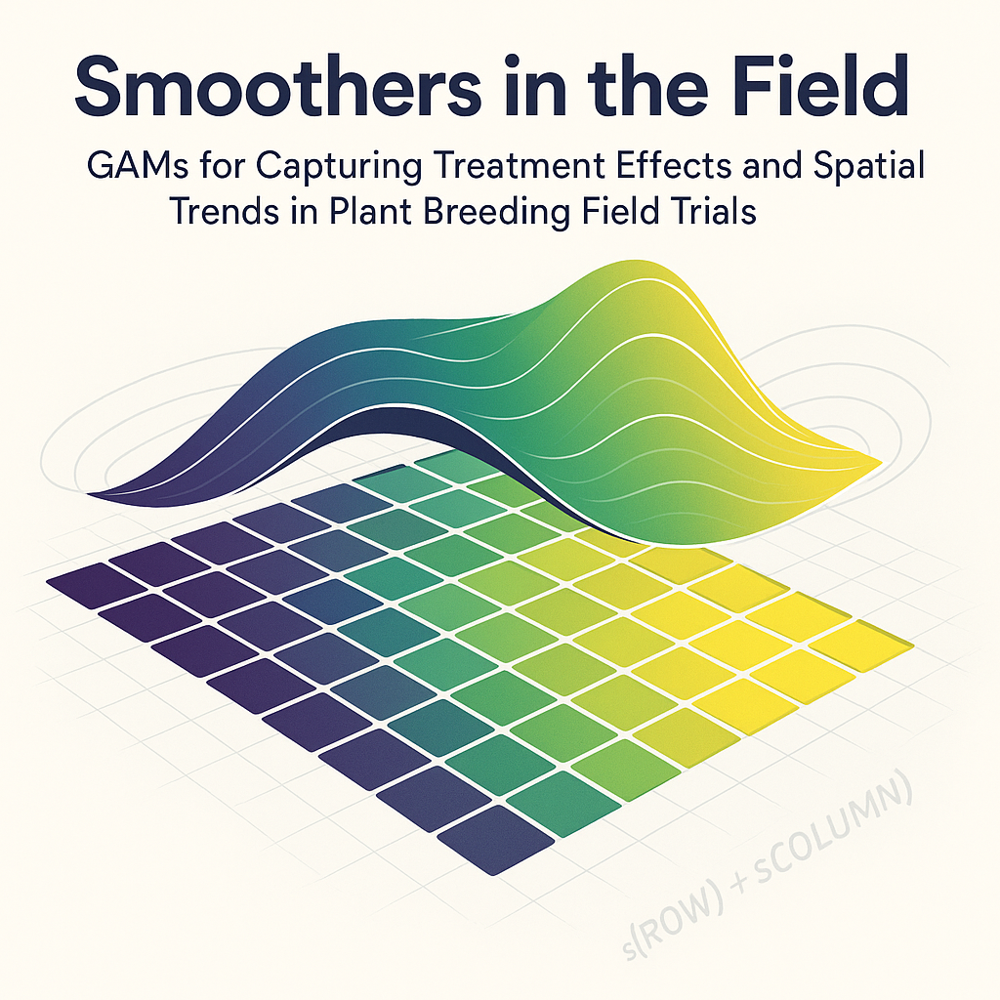

```{r setup, include=FALSE, comment=NA}
knitr::opts_chunk$set(
  echo = TRUE,
  warning = FALSE,
  message = FALSE,
  comment = NA
)
```




```{r, echo=FALSE, eval=TRUE, warning=FALSE, comment=NA, include=FALSE}
suppressMessages({
  suppressWarnings({
    library(mgcv)        # GAMs: bam(), s(), te()
    library(asreml)      # ASReml-R (requires a license)
    library(dplyr)
    library(tidyr)
    library(ggplot2)
    library(patchwork)
    library(kableExtra)
    library(viridis)
  })
})
```

```{r, echo=FALSE, eval=TRUE, warning=FALSE, comment=NA}
my_theme <- theme_minimal(base_size = 13) +
  theme(
    plot.title = element_text(face = "bold", hjust = 0.5),
    axis.title.x = element_text(size = 12, margin = margin(t = 8)),
    axis.title.y = element_text(size = 12, margin = margin(r = 8)),
    axis.text.x  = element_text(size = 8, angle = 90, vjust = 0.5, hjust = 1),
    axis.text.y  = element_text(size = 8),
    legend.position = "top",
    legend.title = element_text(size = 11),
    legend.text = element_text(size = 10),
    panel.grid.major = element_blank(),
    panel.grid.minor = element_blank()
  )
```


### Introduction

Field trials are central to plant breeding: they tell us how genotypes perform across environments. But fields are not uniform. Spatial trends caused by soil variability, irrigation, or microclimate gradients add noise that can hide the true genetic signal. Linear mixed models have long been the standard tool for handling this spatial structure while estimating treatment effects.

Generalized Additive Models (GAMs) offer a flexible, non-parametric alternative. They can model smooth spatial surfaces and complex field patterns, yet they are still rarely used in plant breeding. In this article, we apply GAMs to field trial data and compare them with a classical spatial mixed model fitted in ASReml. We focus on three questions:

- How well does each model fit the data (model diagnostics)?
- How well does each model capture the spatial trend?
- Do the two models agree on genotype rankings (measured with correlation and Kendall's tau)?

### Data

The dataset comes from a simulation study based on a partially replicated (p-rep) field trial design, with 180 genotypes (treatments) evaluated across five environments. To keep things simple, we focus on a single environment (`LOC1`) and run a within-location spatial analysis. The dataset includes the field layout (row and column positions), genotype identifiers (treatments), and grain yield, our response variable.

> **Note:** Throughout this article, we use the terms *genotype* and *treatment* interchangeably. Each treatment corresponds to a unique genotype evaluated in the field trial.

The first rows of the raw data look like this:

```{r, echo=FALSE, eval=TRUE, comment=NA}
yield_data <- read.csv("FARGO_pREP_2025-04-18.csv")
head(yield_data) |> kable()
```

We keep only `LOC1`, convert `TREATMENT`, `ROW`, and `COLUMN` to factors (used later as random effects), and sort the plots by row and column. The `AR_start` column marks the first plot of each row; we need it later to model residual autocorrelation.

```{r, echo=TRUE}
yield_data_single_gam <- yield_data |>
	filter(LOCATION == "LOC1") |>
	mutate(
		TREATMENT  = as.factor(TREATMENT),
		ROW_fc     = as.factor(ROW),
		COLUMN_fc  = as.factor(COLUMN)
	) |>
	arrange(ROW, COLUMN) |>
	group_by(ROW) |>
	mutate(AR_start = row_number() == 1) |>
	ungroup()
```

### Basic GAM Model

A GAM replaces strictly linear terms with smooth functions estimated from the data. For example, instead of assuming that yield changes linearly from row to row, we estimate a smooth function $f_1(ROW)$. This lets the model capture gradual trends across the field that would otherwise end up in the random effects or the residuals.

#### Model Equation

We model the yield $y_{ijk}$ of the plot in row $i$ and column $j$, planted with treatment $k$, as:

<div style="font-size: 80%">
$$y_{ijk} = \beta_0 + f_1(ROW_i) + f_2(COLUMN_j) + f_3(ROW_{fc,i}) + f_4(COLUMN_{fc,j}) + f_5(TREATMENT_k) + \varepsilon_{ijk}$$
</div>

Where:

- $\beta_0$ is the overall intercept.

- $f_1$ and $f_2$ are smooth spatial trends along rows and columns, modeled with penalized splines (`bs = "ps"`).

- $f_3$ and $f_4$ are random row and column effects (`bs = "re"`).

- $f_5$ is the random treatment (genotype) effect (`bs = "re"`).

- $\varepsilon_{ijk}$ is the residual error.

We fit the model with the `bam()` function from the `mgcv` package:

```{r, echo=TRUE}
gam_m1 <- bam(
	YIELD ~
		s(ROW, bs = "ps") + s(COLUMN, bs = "ps") +
		s(ROW_fc, bs = "re") + s(COLUMN_fc, bs = "re") +
		s(TREATMENT, bs = "re"),
	data = yield_data_single_gam,
	method = "fREML"
)
```

#### Genotype-Level Predictions - GAM

To get one predicted value per genotype, we build a prediction dataset with one row per genotype. The smooth trends ($f_1$ and $f_2$) are evaluated at the center of the field, and the random row and column effects ($f_3$ and $f_4$) are excluded, which sets them to zero (their expected value). This way, every genotype is predicted under the same "average" field conditions.

```{r, echo=TRUE, eval=TRUE, comment=NA}
# Field-center values for the smooth spatial trends
mean_row <- mean(yield_data_single_gam$ROW)
mean_column <- mean(yield_data_single_gam$COLUMN)

# One row per genotype at the center of the field.
# ROW_fc and COLUMN_fc must be present in newdata, but their effects are
# excluded at prediction time, so any valid level can be used here.
newdata_gam <- tibble::tibble(
	TREATMENT = levels(yield_data_single_gam$TREATMENT),
	ROW = mean_row,
	COLUMN = mean_column,
	ROW_fc = yield_data_single_gam$ROW_fc[1],
	COLUMN_fc = yield_data_single_gam$COLUMN_fc[1]
)
```

We also define a small helper function that adds 95% confidence intervals to a table of predictions:

```{r, echo=TRUE, eval=TRUE, comment=NA}
# Add confidence intervals
add_confidence_intervals <- function(tbl, pred_col, se_col, level = 0.95) {
  z <- qnorm(1 - (1 - level) / 2)
  tbl |>
    mutate(
      lower = {{ pred_col }} - z * {{ se_col }},
      upper = {{ pred_col }} + z * {{ se_col }}
    )
}
```

Then we use `newdata_gam` to predict from the GAM model:

```{r, echo=TRUE, eval=TRUE, comment=NA}
preds_treatment <- predict(
	gam_m1,
	newdata = newdata_gam,
	se.fit = TRUE,
	type = "response",
	exclude = c("s(ROW_fc)", "s(COLUMN_fc)")
)

BLUPs_gam_single <- newdata_gam |>
	mutate(
		predicted_value = preds_treatment$fit,
		se = preds_treatment$se.fit
	) |>
	add_confidence_intervals(pred_col = predicted_value, se_col = se) |>
	select(TREATMENT, predicted_value, se, lower, upper)
```

The result contains the predicted yield for each genotype, its standard error, and its 95% confidence interval:

```{r echo=FALSE, eval=TRUE, comment=NA}
BLUPs_gam_single |> head(10) |> kable()
```


### Basic ASReml Model

To put the GAM results in context, we fit a traditional linear mixed model with ASReml. This model includes fixed linear effects for `ROW` and `COLUMN`, random spline terms (`spl()`) that capture smooth deviations from those linear trends, and a random effect for genotype (`TREATMENT`). Its structure mirrors the GAM, so we can fairly compare the best linear unbiased predictions (BLUPs) and the spatial adjustment of both models.

ASReml-R requires the data to be sorted in the same order as the spatial structure, so we sort the plots by row and then by column:

```{r, echo=TRUE, eval=TRUE}
yield_data_single_asreml <- yield_data_single_gam |>
	arrange(ROW_fc, COLUMN_fc)
```

The equivalent mixed model, fitted with the `asreml` R package (ASReml-R, which requires a license), is:

```{r asreml_model0, eval=FALSE, echo=TRUE, message=FALSE, warning=FALSE}
asreml_m1 <- asreml(
	fixed = YIELD ~ ROW + COLUMN,
	random = ~ spl(ROW) + spl(COLUMN) + TREATMENT,
	data = yield_data_single_asreml,
	trace = FALSE
)

# Refit from the current estimates to make sure the model has converged
asreml_m1 <- update(asreml_m1)
```


```{r asreml_model1, eval=TRUE, echo=FALSE, message=FALSE, warning=FALSE, results='hide', include=FALSE}
suppressMessages({
  suppressWarnings({
			asreml_m1 <- asreml(
				fixed = YIELD ~ ROW + COLUMN,
				random = ~ spl(ROW) + spl(COLUMN) + TREATMENT,
				data = yield_data_single_asreml,
				trace = FALSE
			)

			asreml_m1 <- update(asreml_m1)

			pred_asreml <- predict(asreml_m1, classify = "TREATMENT", sed = TRUE)$pvals
  })
})
```

#### Genotype-Level Predictions - ASReml

Once the ASReml model is fitted, extracting genotype predictions is straightforward with the `predict()` function. We then add 95% confidence intervals based on the standard errors:

```{r, eval=FALSE, echo=TRUE, message=FALSE, warning=FALSE, results='hide'}
pred_asreml <- predict(asreml_m1, classify = "TREATMENT", sed = TRUE)$pvals

pred_asreml |>
	add_confidence_intervals(pred_col = predicted.value, se_col = std.error)
```


```{r, eval=TRUE, echo=FALSE}
pred_asreml |>
	add_confidence_intervals(pred_col = predicted.value, se_col = std.error) |>
	head(10) |>
	kable()
```

### Model Fit Diagnostics

To check how well each model captures spatial variation and explains yield variability, we start with three standard diagnostic plots: a histogram of the residuals, residuals versus fitted values, and a QQ plot. The figure below shows these plots for the GAM fitted in the previous section.

```{r, fig.align="c", fig.width=11, fig.height=3.5, echo=FALSE, eval=TRUE}
# Residuals for model fit check
yield_data_gam_res <- yield_data_single_gam |>
	mutate(
		fitted = predict(gam_m1, type = "response"),
		residual = residuals(gam_m1, type = "response")
	)

# Histogram of Residuals
hist_plot <- ggplot(yield_data_gam_res, aes(x = residual)) +
	geom_histogram(binwidth = 0.3, fill = "steelblue", color = "black") +
	labs(
		title = "Histogram of Residuals (GAM)",
		x = "Residual",
		y = "Frequency"
	) +
	theme_minimal(base_size = 10)

# Residuals vs Fitted
resid_fit_plot <- ggplot(yield_data_gam_res, aes(x = fitted, y = residual)) +
	geom_point(alpha = 0.8, color = "black") +
	geom_smooth(method = "loess", se = FALSE, color = "red", linewidth = 0.8) +
	labs(
		x = "Fitted Values",
		y = "Residuals",
		title = "Residuals vs Fitted Values (GAM)"
	) +
	theme_minimal(base_size = 10)

# QQ Plot
qq_plot <- ggplot(yield_data_gam_res, aes(sample = residual)) +
	stat_qq(color = "darkgreen") +
	stat_qq_line(color = "black", linewidth = 0.8) +
	labs(
		title = "QQ Plot of Residuals (GAM)",
		x = "Theoretical Quantiles",
		y = "Sample Quantiles"
	) +
	theme_minimal(base_size = 10)

# Arrange the three plots side by side
(hist_plot | resid_fit_plot | qq_plot)
```

Here are the same diagnostic plots for the linear mixed model fitted with ASReml:

```{r, fig.align="c", fig.width=11, fig.height=3.5, echo=FALSE, eval=TRUE}
# Residuals for model fit check
yield_data_single_asreml_res <- yield_data_single_asreml |>
	dplyr::mutate(
		fitted = fitted(asreml_m1),
		residual = residuals(asreml_m1, type = "response")
	)

# Histogram of Residuals
hist_plot <- ggplot(yield_data_single_asreml_res, aes(x = residual)) +
	geom_histogram(binwidth = 0.3, fill = "steelblue", color = "black") +
	labs(
		title = "Histogram of Residuals (ASReml)",
		x = "Residual",
		y = "Frequency"
	) +
	theme_minimal(base_size = 10)

# Residuals vs Fitted
resid_fit_plot <- ggplot(yield_data_single_asreml_res, aes(x = fitted, y = residual)) +
	geom_point(alpha = 0.8, color = "black") +
	geom_smooth(method = "loess", se = FALSE, color = "red", linewidth = 0.8) +
	labs(
		x = "Fitted Values",
		y = "Residuals",
		title = "Residuals vs Fitted Values (ASReml)"
	) +
	theme_minimal(base_size = 10)

# QQ Plot
qq_plot <- ggplot(yield_data_single_asreml_res, aes(sample = residual)) +
	stat_qq(color = "darkgreen") +
	stat_qq_line(color = "black", linewidth = 0.8) +
	labs(
		title = "QQ Plot of Residuals (ASReml)",
		x = "Theoretical Quantiles",
		y = "Sample Quantiles"
	) +
	theme_minimal(base_size = 10)

# Arrange the three plots side by side
(hist_plot | resid_fit_plot | qq_plot)
```

The diagnostic plots reveal some clear issues in both models:

- **Residuals vs fitted values:** the residuals form clusters, which likely reflects correlation between neighboring plots. The models have not fully accounted for spatial dependence in the errors.
- **QQ plots:** the residuals deviate from normality, especially in the tails.
- **Histograms:** the residual distributions are slightly skewed.

Together, these patterns point to spatial structure that the models have not captured yet, so there is room to improve both approaches.

### Improving the GAM Model

To push the flexibility of GAMs further, we add a richer spatial structure to the model, with the goal of capturing the remaining spatial trends and improving the fit. ASReml supports two-dimensional autoregressive residual structures (`AR1 ⊗ AR1`), but `mgcv` can only model autoregressive errors along one dimension. To make up for this, we add a tensor product between the row and column factors using random effect bases (`bs = "re"`). This row × column interaction works like a spatial nugget: it captures plot-level deviations that the marginal row and column effects cannot explain.

We also model residual correlation between neighboring plots within each row using an `AR(1)` process. The `AR_start` column created earlier tells `bam()` where each row begins, so the correlation does not carry over from the end of one row to the start of the next. Because `mgcv::bam()` does not estimate the autocorrelation parameter `rho`, we have to supply it ourselves. We chose it with a simple grid search, keeping the value with the lowest REML score:

```{r rho_search, eval=FALSE, echo=TRUE}
# Grid search for the AR(1) parameter rho (lower REML score is better)
test_rho <- function(rho_val) {
	bam(
		YIELD ~
			s(ROW, bs = "ps") + s(COLUMN, bs = "ps") +
			s(ROW_fc, bs = "re") + s(COLUMN_fc, bs = "re") +
			s(TREATMENT, bs = "re") +
			te(ROW_fc, COLUMN_fc, bs = c("re", "re")),
		rho = rho_val,
		AR.start = yield_data_single_gam$AR_start,
		data = yield_data_single_gam,
		method = "fREML"
	)$gcv.ubre
}

rhos <- seq(0.1, 0.95, by = 0.05)
scores <- sapply(rhos, test_rho)

data.frame(rho = rhos, reml_score = scores) |>
	arrange(reml_score) |>
	head(5)
```

The lowest REML score was reached at `rho = 0.55`, which we use in the final model.

The upgraded GAM model can be written as:

<div style="font-size: 80%">
$$y_{ijk} = \beta_0 + f_1(ROW_i) + f_2(COLUMN_j) + f_3(ROW_{fc,i}) + f_4(COLUMN_{fc,j}) + f_5(TREATMENT_k) +$$
$$f_6(ROW_{fc,i}, COLUMN_{fc,j}) + \varepsilon_{ijk}$$
</div>

Where:

- $f_6$ is the tensor product interaction between rows and columns, with random effect bases (`bs = "re"`) for both factors.

- $\varepsilon_{ijk}$ now follows an `AR(1)` process within each row, with `rho = 0.55`.

In `mgcv`, the model is specified as follows:

```{r}
gam_m2 <- bam(
	YIELD ~
		s(ROW, bs = "ps") + s(COLUMN, bs = "ps") +
		s(ROW_fc, bs = "re") + s(COLUMN_fc, bs = "re") +
		s(TREATMENT, bs = "re") +
		te(ROW_fc, COLUMN_fc, bs = c("re", "re")),
	rho = 0.55,
	AR.start = yield_data_single_gam$AR_start,
	data = yield_data_single_gam,
	method = "fREML"
)
```

We predict genotype values in the same way as before. This time, we also exclude the row × column interaction term:

```{r, comment=NA, eval=TRUE, echo=TRUE, message=FALSE, warning=FALSE}
preds_treatment <- predict(
	gam_m2,
	newdata = newdata_gam,
	se.fit = TRUE,
	type = "response",
	exclude = c("s(ROW_fc)", "s(COLUMN_fc)", "te(ROW_fc,COLUMN_fc)")
)

BLUPs_gam_single2 <- newdata_gam |>
	mutate(
		predicted_value = preds_treatment$fit,
		se = preds_treatment$se.fit
	) |>
	add_confidence_intervals(pred_col = predicted_value, se_col = se) |>
	select(TREATMENT, predicted_value, se, lower, upper)
```

The first ten predictions from the upgraded GAM model are:

```{r comment=NA, eval=TRUE, echo=FALSE, message=FALSE, warning=FALSE}
BLUPs_gam_single2 |>
	head(10) |>
	kable()
```

### Fully Spatial ASReml Model

To take full advantage of ASReml's spatial modeling capabilities, we extend the previous model with a two-dimensional autoregressive (`AR1 ⊗ AR1`) residual structure. This lets the model directly account for residual correlation across both the rows and the columns of the field, which is one of ASReml's key strengths.

```{r asreml_model02, eval=FALSE, echo=TRUE, message=FALSE, warning=FALSE}
asreml_m2 <- asreml(
	fixed = YIELD ~ ROW + COLUMN,
	random = ~ spl(ROW) + spl(COLUMN) + TREATMENT,
	residual = ~ ar1(ROW_fc):ar1(COLUMN_fc),
	data = yield_data_single_asreml,
	trace = FALSE
)

asreml_m2 <- update(asreml_m2)
```


```{r asreml_model12, eval=TRUE, echo=FALSE, message=FALSE, warning=FALSE, include=FALSE}
suppressMessages({
  suppressWarnings({
			asreml_m2 <- asreml(
				fixed = YIELD ~ ROW + COLUMN,
				random = ~ spl(ROW) + spl(COLUMN) + TREATMENT,
				residual = ~ ar1(ROW_fc):ar1(COLUMN_fc),
				data = yield_data_single_asreml,
				trace = FALSE
			)

			asreml_m2 <- update(asreml_m2)
			pred_asreml2 <- predict(asreml_m2, classify = "TREATMENT", sed = TRUE)$pvals
  })
})
```

#### Genotype-Level Predictions - Spatial ASReml

The predictions from the updated ASReml model are obtained the same way:

```{r, eval=FALSE, echo=TRUE, message=FALSE, warning=FALSE, results='hide'}
pred_asreml2 <- predict(asreml_m2, classify = "TREATMENT", sed = TRUE)$pvals

pred_asreml2 |>
	add_confidence_intervals(pred_col = predicted.value, se_col = std.error)
```


```{r, eval=TRUE, echo=FALSE}
pred_asreml2 |>
	add_confidence_intervals(pred_col = predicted.value, se_col = std.error) |>
	head(10) |>
	kable()
```

### Model Fit Diagnostics: Spatial Models

Now let's check the diagnostics of the new models. The figure below shows the residual histogram, residuals versus fitted values, and the QQ plot for the upgraded GAM.

```{r, fig.align="c", fig.width=11, fig.height=3.5, echo=FALSE, eval=TRUE}
# Residuals for model fit check
yield_data_gam_res2 <- yield_data_single_gam |>
	mutate(
		fitted = predict(gam_m2, type = "response"),
		residual = residuals(gam_m2, type = "response")
	)

# Histogram of Residuals
hist_plot <- ggplot(yield_data_gam_res2, aes(x = residual)) +
	geom_histogram(binwidth = 0.3, fill = "steelblue", color = "black") +
	labs(
		title = "Histogram of Residuals (GAM)",
		x = "Residual",
		y = "Frequency"
	) +
	theme_minimal(base_size = 10)

# Residuals vs Fitted
resid_fit_plot <- ggplot(yield_data_gam_res2, aes(x = fitted, y = residual)) +
	geom_point(alpha = 0.8, color = "black") +
	geom_smooth(method = "loess", se = FALSE, color = "red", linewidth = 0.8) +
	labs(
		x = "Fitted Values",
		y = "Residuals",
		title = "Residuals vs Fitted Values (GAM)"
	) +
	theme_minimal(base_size = 10)

# QQ Plot
qq_plot <- ggplot(yield_data_gam_res2, aes(sample = residual)) +
	stat_qq(color = "darkgreen") +
	stat_qq_line(color = "black", linewidth = 0.8) +
	labs(
		title = "QQ Plot of Residuals (GAM)",
		x = "Theoretical Quantiles",
		y = "Sample Quantiles"
	) +
	theme_minimal(base_size = 10)

# Arrange the three plots side by side
(hist_plot | resid_fit_plot | qq_plot)
```

And these are the same plots for the spatial ASReml model:

```{r, fig.align="c", fig.width=11, fig.height=3.5, echo=FALSE, eval=TRUE}
# Residuals for model fit check
yield_data_single_asreml_res2 <- yield_data_single_asreml |>
	dplyr::mutate(
		fitted = fitted(asreml_m2),
		residual = residuals(asreml_m2, type = "response")
	)

# Histogram of Residuals
hist_plot <- ggplot(yield_data_single_asreml_res2, aes(x = residual)) +
	geom_histogram(binwidth = 0.3, fill = "steelblue", color = "black") +
	labs(
		title = "Histogram of Residuals (ASReml)",
		x = "Residual",
		y = "Frequency"
	) +
	theme_minimal(base_size = 10)

# Residuals vs Fitted
resid_fit_plot <- ggplot(yield_data_single_asreml_res2, aes(x = fitted, y = residual)) +
	geom_point(alpha = 0.8, color = "black") +
	geom_smooth(method = "loess", se = FALSE, color = "red", linewidth = 0.8) +
	labs(
		x = "Fitted Values",
		y = "Residuals",
		title = "Residuals vs Fitted Values (ASReml)"
	) +
	theme_minimal(base_size = 10)

# QQ Plot
qq_plot <- ggplot(yield_data_single_asreml_res2, aes(sample = residual)) +
	stat_qq(color = "darkgreen") +
	stat_qq_line(color = "black", linewidth = 0.8) +
	labs(
		title = "QQ Plot of Residuals (ASReml)",
		x = "Theoretical Quantiles",
		y = "Sample Quantiles"
	) +
	theme_minimal(base_size = 10)

# Arrange the three plots side by side
(hist_plot | resid_fit_plot | qq_plot)
```


Compared with the earlier models, the new diagnostic plots show a clear improvement in fit for both GAM and ASReml:

- **Histograms of residuals:** The residuals of both models are now more symmetric around zero, with no major skewness or multiple peaks.

- **Residuals vs fitted values:** The systematic clustering seen earlier has largely disappeared. The residuals now scatter randomly around zero with a similar spread across the range of fitted values, which means the models have absorbed most of the spatial structure. The slight curvature in the LOESS line is minor, is common in spatial data, and no longer signals a serious misspecification.

- **QQ plots:** Both models now follow the theoretical normal line more closely, especially in the center of the distribution. Some deviation remains in the tails, but overall the residuals are consistent with a normal distribution.

Together, these results show that adding spatial structure, an `AR1 ⊗ AR1` residual structure in ASReml and a tensor product plus `AR(1)` errors in the GAM, greatly improves both models' ability to capture field variability. Both models now provide a much more reliable basis for estimating treatment effects.

#### Residual Heatmaps

To see the spatial pattern of the residuals, we plot them on the field layout as heatmaps. Each tile is a plot in the field, and its color shows the size and sign of the residual (observed minus fitted yield):

- **Dark purple:** large negative residuals (the model *overestimates* yield).

- **Green:** residuals near zero (good fit).

- **Yellow:** large positive residuals (the model *underestimates* yield).

These heatmaps help us spot spatial trends the models missed, such as blocks or streaks of consistently high or low residuals.

```{r, fig.align="c", fig.width=12, fig.height=5, echo=FALSE, eval=TRUE}
heatmap_gam <- ggplot(yield_data_gam_res2, aes(x = COLUMN, y = ROW, fill = residual)) +
	geom_tile(color = "white") +
	scale_fill_viridis(
		option = "viridis",  # purple → green → yellow
		name = "Residual",
		direction = 1
	) +
	scale_x_continuous(breaks = scales::pretty_breaks(n = 10)) +
	scale_y_continuous(breaks = scales::pretty_breaks(n = 10)) +
	labs(
		title = "Spatial Heatmap of Residuals (GAM)",
		x = "Column",
		y = "Row"
	) +
	theme_minimal(base_size = 13) +
	theme(
		plot.title = element_text(face = "bold", hjust = 0.5),
		legend.position = "right"
	)

heatmap_asreml <- ggplot(yield_data_single_asreml_res2, aes(x = COLUMN, y = ROW, fill = residual)) +
	geom_tile(color = "white") +
	scale_fill_viridis(
		option = "viridis",  # purple → green → yellow
		name = "Residual",
		direction = 1
	) +
	scale_x_continuous(breaks = scales::pretty_breaks(n = 10)) +
	scale_y_continuous(breaks = scales::pretty_breaks(n = 10)) +
	labs(
		title = "Spatial Heatmap of Residuals (ASReml)",
		x = "Column",
		y = "Row"
	) +
	theme_minimal(base_size = 13) +
	theme(
		plot.title = element_text(face = "bold", hjust = 0.5),
		legend.position = "right"
	)

# Combine plots with a shared legend
(heatmap_gam | heatmap_asreml) +
  plot_layout(guides = "collect") &
  theme(legend.position = "right")
```

The GAM residuals are mostly close to zero, with only a few isolated high values, so the spatial pattern was captured well. The ASReml residuals are also well controlled, with only a few small clusters. Overall, both models fit the spatial structure well, and the heatmaps show no major patterns left unmodeled.

### Model Predictions: Correlation and Rankings

How much do the two approaches agree? Here we compare the predictions from the GAM with those from the linear mixed model (LMM) fitted in ASReml. We look at two things that matter for selection decisions in breeding programs: the correlation between predicted values and the consistency of genotype rankings.

#### Correlation of Predicted Values

We first match the predictions of both models by genotype and then compute their Pearson correlation:

```{r comment=NA}
pred_comparison <- BLUPs_gam_single2 |>
	dplyr::select(TREATMENT, pred_gam = predicted_value) |>
	dplyr::inner_join(
		pred_asreml2 |> dplyr::select(TREATMENT, pred_asreml = predicted.value),
		by = "TREATMENT"
	)

cor(pred_comparison$pred_gam, pred_comparison$pred_asreml)
```

The correlation between the GAM and ASReml predictions is remarkably close to 1.0. Despite the structural differences between the models, both approaches give very similar treatment effects. This supports the idea that GAMs are a robust option for spatial modeling in field trials.

#### Agreement in Genotype Rankings

Genotype rankings drive key breeding decisions such as advancement, selection, and crossing, which all depend on identifying the top-performing entries. To check ranking agreement, we compute the rank correlation between the two models with Kendall's tau, a non-parametric measure of how consistently pairs of genotypes are ordered.

```{r echo=TRUE, eval=TRUE, comment=NA}
# GAM ranks (rank 1 = highest predicted yield)
rank_gam_total <- BLUPs_gam_single2 |>
	dplyr::select(TREATMENT, predicted_value) |>
	dplyr::mutate(rank_gam_total = rank(-predicted_value))

# ASReml ranks
rank_asreml <- pred_asreml2 |>
	dplyr::select(TREATMENT, predicted.value) |>
	dplyr::mutate(rank_asreml = rank(-predicted.value))

# Compare ranks
rank_comparison <- rank_gam_total |>
	dplyr::inner_join(rank_asreml, by = "TREATMENT") |>
	dplyr::mutate(diff = rank_gam_total - rank_asreml)
```

#### Kendall Correlation

```{r}
cor(rank_comparison$rank_gam_total, rank_comparison$rank_asreml, method = "kendall")
```

Kendall's tau across all genotypes is high, which shows strong agreement between the GAM and ASReml rankings.

Breeders, however, usually care most about the top of the list. To mimic a real selection decision, we look at the top-N genotypes of each model for several values of N. For each threshold, we compute the percentage of genotypes selected by both models (`shared_pct`) and Kendall's tau among those shared genotypes (`kendall_tau`):

```{r, eval=TRUE, echo=TRUE}
compare_top_n <- function(rank_tbl, top_n) {
	top_gam    <- rank_tbl$TREATMENT[rank_tbl$rank_gam_total <= top_n]
	top_asreml <- rank_tbl$TREATMENT[rank_tbl$rank_asreml <= top_n]
	shared     <- intersect(top_gam, top_asreml)
	shared_tbl <- dplyr::filter(rank_tbl, TREATMENT %in% shared)

	data.frame(
		Top = top_n,
		kendall_tau = round(cor(shared_tbl$rank_gam_total, shared_tbl$rank_asreml, method = "kendall"), 3),
		shared_pct = round(100 * length(shared) / top_n, 1)
	)
}

rankings <- do.call(
	rbind,
	lapply(c(10, 20, 30, 40, 50), compare_top_n, rank_tbl = rank_comparison)
)
```


```{r, eval=TRUE, echo=FALSE}
rankings |> kable()
```


The table shows that even when Kendall's tau falls slightly below 1.0, the two models select nearly the same top genotypes. This is an important insight for breeding decisions: small differences in rank order do not necessarily change the selection outcome, as long as the set of top genotypes stays the same. A Kendall's tau of `1.0` means the shared genotypes appear in exactly the same order in both models. With slightly lower values, the models can still select exactly the same genotypes. This happens when small differences in predicted values reshuffle the order within the top group without changing who is in it.

The plot below shows the rank agreement. Each point is a genotype, and the dashed line marks perfect agreement. The rankings from the GAM and ASReml models are closely aligned:

```{r, fig.align="c", fig.width=8, fig.height=5, echo=FALSE, eval=TRUE}
ggplot(rank_comparison, aes(x = rank_asreml, y = rank_gam_total)) +
	geom_point(size = 2.5, color = "darkgreen") +
	geom_abline(slope = 1, intercept = 0, linetype = "dashed", color = "red") +
	labs(
		title = "Rank Comparison: ASReml vs GAM (Predicted Genotype Values)",
		x = "ASReml Rank",
		y = "GAM Rank"
	) +
	theme_minimal(base_size = 13) +
	theme(
		plot.title = element_text(face = "bold", hjust = 0.5),
		axis.title.x = element_text(size = 12),
		axis.title.y = element_text(size = 12),
		axis.text.x  = element_text(size = 8, angle = 90, vjust = 0.5, hjust = 1),
		axis.text.y  = element_text(size = 8),
		legend.position = "top",
		legend.title = element_text(size = 11),
		legend.text = element_text(size = 10),
		panel.grid.major.x = element_blank()
	)
```

Finally, we compare the standard errors of the predicted values, which show how each model estimates uncertainty.

```{r, fig.align="c", fig.width=12, fig.height=7, echo=FALSE, eval=TRUE}
# Prepare long-format data
se_long <- BLUPs_gam_single2 |>
	select(TREATMENT, se_gam = se) |>
	left_join(
		pred_asreml2 |> select(TREATMENT, se_asreml = std.error),
		by = "TREATMENT"
	) |>
	pivot_longer(
		cols = c(se_gam, se_asreml),
		names_to = "model",
		values_to = "se"
	) |>
	mutate(
		model = recode(model, se_gam = "GAM", se_asreml = "ASReml"),
		TREATMENT = factor(TREATMENT, levels = unique(TREATMENT))  # preserve order
	)

# Plot
ggplot(se_long, aes(x = TREATMENT, y = se, group = model, color = model)) +
  geom_line(linewidth = 1) +
  geom_point(size = 1.5) +
  scale_color_manual(values = c("GAM" = "#1b9e77", "ASReml" = "#d95f02")) +
  labs(
    title = "Standard Errors of Treatment Predictions by Model",
    x = "Genotype (Treatment)",
    y = "Standard Error",
    color = "Model"
  ) +
  my_theme
```

Despite their different formulations, GAM and ASReml produce strikingly similar standard errors across genotypes, with the GAM appearing slightly more conservative. It is reassuring that both models give consistent estimates of the uncertainty around the genotype predictions.

### Conclusions

Generalized Additive Models (GAMs) provide a flexible and interpretable framework for capturing spatial variation and estimating treatment effects in field trials. In this study, we compared a GAM with a classical spatial linear mixed model fitted in ASReml. Despite their structural differences, both models produced nearly identical genotype predictions and rankings once the spatial structure was properly modeled.

Our goal was not to decide which model is better, but to show how GAMs can be used in practice and how their results compare with established methods. As the saying goes, "All models are wrong, but some are useful." Neither GAM nor ASReml is perfect, but both are useful tools that offer valuable insights when used thoughtfully in plant breeding pipelines.

### Reproducibility

The full code used in this analysis is available on GitHub:

<a href="https://github.com/DidierMurilloF/PhenoGAMs" target="_blank">
  
</a>

### References

This work draws inspiration from the book _Generalized Additive Models: An Introduction with R (2nd Edition)_ by Simon Wood, an accessible and practical guide to understanding and implementing GAMs with the `mgcv` package.


### About the Author

**Didier Murillo** is a statistician and R Shiny developer specializing in agricultural data analytics at North Dakota State University (NDSU). His work focuses on experimental design, predictive pipelines, and the integration of genomic and phenotypic data for predictive modeling in plant breeding. He also develops robust R Shiny applications that turn complex analytical workflows into user-friendly web tools for researchers, breeders, and stakeholders.

### Connect with Didier on

<a href="https://github.com/DidierMurilloF" target="_blank">
  
</a>
<a href="https://www.linkedin.com/in/damurillof/" target="_blank">
  
</a>
